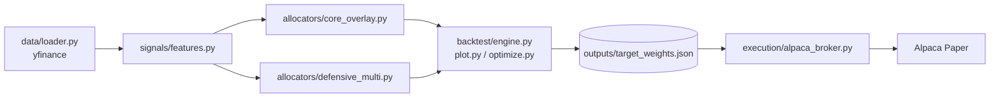

# unified-regime-portfolio

市場ストレス指標（ボラティリティ・資産間相関・Amihud 非流動性）をもとに ETF ポートフォリオを組む2つの戦略を同じデータ基盤と評価エンジンで比較し、最新の目標ウェイトを Alpaca のペーパー口座へ安全に発注するところまでを1つの CLI にまとめたリポジトリです。

次の3リポジトリを統合しています。

- conditional-alpha-portfolio（戦略①: SPY コア + ゲート付きオーバーレイ）
- liquidity-crowding-portfolio（戦略②: 流動性・混雑度オーバーレイ付きの月次モメンタム）
- alpaca_bot（Alpaca ペーパー執行と安全ガード）

> 研究用のコードです。発注先は Alpaca のペーパー口座に固定しており実資金は扱いません。

## 設計思想

1. **データ基盤の統一**　リターンには分割・分配を反映した調整後終値を使い、Amihud 非流動性には未調整の終値×出来高（ドル出来高）を使います。用途ごとに価格系列を分けて取得する共通ローダーで、リポジトリ①で欠落していた `loader.py` も置き換えています。
2. **Strategy パターンによるアロケーターの抽象化**　どちらの戦略も `generate_daily_weights(prices, dollar_vol)` という同じ入口を持ちます。CLI の `--strategy` だけで切り替えられ、同じエンジンと同じコスト前提で比較できます。
3. **リサーチと執行を JSON で結合**　バックテストの完了時に最新日の目標ウェイトを `outputs/target_weights.json` に書き出し、執行側はこのファイルだけを読んで発注します。ウェイトを手で書き換える工程はありません。

## アーキテクチャ

```text
unified-regime-portfolio/
├── .env.example                 # Alpaca APIキー設定テンプレート
├── .gitignore
├── requirements.txt
├── README.md
├── main.py                      # 統合CLI（backtest / rebalance / audit）
├── outputs/                     # 実行時に生成（target_weights.json, 成績CSV, チャートPNG）
├── logs/                        # 実行時に生成（trade_log.jsonl, last_run.json）
└── src/
    ├── data/loader.py           # yfinance取得（調整後終値 + 未調整ドル出来高）
    ├── signals/features.py      # Zスコア、相関、Amihud、日次Crowdingスコア、月次シグナル
    ├── allocators/
    │   ├── base.py              # アロケーター抽象基底クラス
    │   ├── core_overlay.py      # 戦略①
    │   └── defensive_multi.py   # 戦略②
    ├── backtest/
    │   ├── engine.py            # shift(1)執行・コスト控除・成績指標・レジーム別評価
    │   ├── optimize.py          # core_overlay用の上限付きランダムサーチ
    │   └── plot.py              # 累積リターン・ドローダウン・レジーム別成績のPNG
    └── execution/
        └── alpaca_broker.py     # JSON読込・6つの安全ガード・冪等ロック・監査
```



依存の向きは data → signals → allocators → backtest / execution の一方向です。執行層はウェイトの計算方法を知らず、JSON の中身だけを見ます。

## 戦略

### 戦略① core_overlay（週次・二値ゲート型）

SPY 100% をコアとして持ち、条件がそろったときだけ小さなオーバーレイを上乗せします。

- **レジーム判定**　SPY の 50日/200日移動平均と126日モメンタムで強気と弱気を判定
- **強気かつ低混雑**　QQQ 60% / IWM 40% のオーバーレイ
- **弱気かつ低混雑かつ TLT が126日平均より上**　TLT 50% / GLD 50% のオーバーレイ
- **混雑度**　非流動性・ボラティリティ・資産間相関の252日Zスコアを 0.2 / 0.3 / 0.5 で合成してシグモイドで 0〜1 に変換。閾値はその日までの拡張窓の80%分位点
- **IR ゲート**　オーバーレイ単体の直近252日アクティブ IR が正のときだけ k = 0.30 を掛けて採用
- **リバランスと上限**　5営業日ごと。オーバーレイのグロス上限 30%、全体のグロス上限 130%

`--optimize` を付けると、データの先頭80%で上限付きランダムサーチ（最大200候補、60候補連続で改善がなければ打ち切り）を行い、末尾20%をホールドアウトとして別に報告します。

### 戦略② defensive_multi（月次・連続スケーリング＋BIL退避型）

- **ベースウェイト**　(12ヶ月リターン − 6ヶ月リターン) の36ヶ月Zスコアが正の資産だけを残し、逆ボラで配分（SPY / QQQ / TLT / GLD）
- **3つの倍率で連続的に縮小**　目標ボラ10% ÷ 平均実現ボラ（上限1.5）と exp(−0.7 × 相関Z) と exp(−0.6 × 非流動性Z)
- **BIL 退避**　余りは BIL へ。BIL が40%を超える月は超過分をリスク資産へ比例で戻す
- **フォールバック**　正のモメンタムを持つ資産がない月やデータ不足の月は BIL 100%

## バックテストの前提

- t 日のウェイトは t 日の終値までの情報だけで決め、t+1 日のリターンに適用します（`shift(1)`）
- コストはウェイト変化の絶対値合計 × `--cost-bps`（既定 10bps）です
- 月次戦略は暦月末のラベルで計算し、ラベル日以降の最初の営業日から適用します。当月の途中までのデータは使いません
- レジーム別成績（LOW_CROWD / HIGH_CROWD）は全期間の80%分位点で事後的に分けた参考値です

## 執行の安全ガード

| # | 内容 | 既定値 |
|---|---|---|
| 1 | `--submit` を付けない限りドライラン。口座は paper に固定 | dry-run |
| 2 | 1注文あたりの想定元本の上限 | `--max-notional 2000` |
| 3 | 総売買代金 ÷ 口座評価額 の上限 | `--max-turnover 0.10` |
| 4 | 1回あたりの注文数の上限 | `--max-orders 5` |
| 5 | 最小発注金額に満たない差分は発注しない | `--min-notional 20` |
| 6 | 冪等ロック。UTC日付で1日1回までとし、未約定の注文が残っていれば送信しない | `logs/last_run.json` |

- ウェイトファイルに載っている銘柄だけを管理対象にします。ウェイト0の銘柄は売却し、ファイルにない保有銘柄には触れません
- 売り注文を先に送って買付余力を確保します
- ドライラン、ガードによる停止、送信のすべてを `logs/trade_log.jsonl` に記録します

既定の上限は少額の調整を想定した値です。空の口座で初めて建てるときはガード2と3に必ずかかるので、ドライランで計画を確認したうえで `--max-notional` と `--max-turnover` を明示的に引き上げてください。core_overlay の既定ウェイトはグロス130%なので信用の買付余力も使います。

## セットアップ

Python 3.10 以上が必要です（Python 3.13 / pandas 3.0 と 2.3 / alpaca-py 0.44 で動作確認）。

```bash
python -m venv .venv
source .venv/bin/activate        # Windows: .venv\Scripts\activate
pip install -r requirements.txt
cp .env.example .env             # Alpaca ペーパー口座のキーを記入
```

## 実行方法

```bash
# Step 1: バックテスト。結果の表示と同時に outputs/target_weights.json を生成
python main.py backtest --strategy core_overlay --start 2010-01-01 --cost-bps 10.0
python main.py backtest --strategy defensive_multi --start 2005-01-01 --cost-bps 10.0

# core_overlay のパラメータをランダムサーチで選ぶ場合
python main.py backtest --strategy core_overlay --optimize

# Step 2: 発注計画をドライランで確認（注文は送信しない）
python main.py rebalance

# Step 3: ガードを確認したうえでペーパー口座へ発注し、口座を監査
python main.py rebalance --submit
python main.py audit
python main.py audit --order-id <注文ID>
```

- `target_weights.json` は最後に実行した `backtest` の戦略で上書きされます。Step 1 の2行を続けて実行すると defensive_multi のウェイトが発注対象になります
- `rebalance` は `execute` という名前でも呼べます
- `backtest` は `--end`（終了日）も指定できます。ランダムサーチの設定は `--n-candidates` `--patience` `--test-frac` `--seed` で変えられます
- yfinance は取引時間中に実行すると当日の途中値を返すため、目標ウェイトの生成は米国市場の引け後に行ってください

### 出力ファイル

`outputs/` と `logs/` は実行時に作られ、git の管理対象外です。

| パス | 内容 |
|---|---|
| `outputs/target_weights.json` | 最新日の目標ウェイト（戦略名・基準日・パラメータ付き） |
| `outputs/<strategy>_daily.csv` | 日次リターン、ターンオーバー、コスト、資産推移、レジーム指標 |
| `outputs/<strategy>_weights.csv` | 日次の目標ウェイト |
| `outputs/<strategy>_metrics.csv` | 成績サマリー（全期間、`--optimize` 時は学習期間と検証期間、レジーム別） |
| `outputs/<strategy>_performance.png` | 累積リターン（対数軸）とドローダウン |
| `outputs/<strategy>_regime.png` | 混雑度レジーム別の成績 |
| `logs/trade_log.jsonl` | 執行の全記録 |
| `logs/last_run.json` | 冪等ロック |

## 参考成績

同一条件での比較です。期間 2010-01-04〜2026-10-09、コスト10bps、既定パラメータ。2026-10-12 に実行した値で、yfinance の調整後価格は分配のたびに過去分も更新されるため再実行すると少し変わります。

| | CAGR | Vol | Sharpe | MDD | Beta | Alpha |
|---|---|---|---|---|---|---|
| core_overlay | 15.19% | 18.83% | 0.85 | -36.53% | 1.09 | -0.17% |
| defensive_multi | 7.41% | 8.10% | 0.92 | -14.57% | 0.15 | 5.32% |
| SPY | 14.20% | 17.04% | 0.86 | -33.72% | 1.00 | 0.00% |

core_overlay の SPY 超過分はほぼベータ1.09のレバレッジによるもので、アルファはほぼゼロです。defensive_multi はリスクを大きく抑える代わりに上昇局面の取り分を手放しています。

defensive_multi は実現ボラを年率換算してから目標ボラ10%と比べます。そのためボラ倍率の中央値は約0.7で、BIL 比率は平均4割ほどになります。統合元の liquidity-crowding-portfolio は月次ボラをそのまま年率の目標と比べていたので、倍率がほぼ常に上限1.5に張り付いていました。旧 README の成績（CAGR 11〜12%）とはこの点が違います。リスク水準を上げたい場合は `DefensiveMultiAllocator(target_vol=...)` を調整してください。

## 統合元リポジトリとの対応

| 統合元 | 統合後 |
|---|---|
| conditional-alpha-portfolio `src/main.py` | `allocators/core_overlay.py`, `backtest/optimize.py`, `main.py` |
| conditional-alpha-portfolio `signals/crowding.py`, `utils/stats.py` | `signals/features.py` |
| conditional-alpha-portfolio `backtest/engine.py`, `backtest/metrics.py`, `utils/plot.py` | `backtest/engine.py`, `backtest/plot.py` |
| liquidity-crowding-portfolio `data.py` | `data/loader.py` |
| liquidity-crowding-portfolio `signals.py`, `portfolio.py`, `backtest.py` | `signals/features.py`, `allocators/defensive_multi.py` |
| alpaca_bot `rebalance_once.py` | `execution/alpaca_broker.py` |
| alpaca_bot `whoami_alpaca.py`, `test_alpaca.py`, `positions.py`, `check_orders.py`, `get_order_by_id.py` | `python main.py audit [--order-id]` |

どこからも使われていなかった `quality.py` `amplify.py` `momentum.py` `alpha_momentum.py` `portfolio/weights.py` と、動作確認用の `order_spy.py` は統合していません。

統合元にあった問題のうち、統合で解消したものは次のとおりです。

- リポジトリ①の `.gitignore` にあった `data/` が `src/data/` にも一致し、`loader.py` がコミットされていなかった。統合後はルート固定の `/data/` にしている
- リポジトリ①の混雑度の閾値は全期間の分位点、IR ゲートは当日ウェイト×当日リターンで計算されていて先読みがあった。拡張窓の分位点と前日ウェイトに変更
- リポジトリ①はホールドアウト期間のシグナルをその期間のデータだけで計算し直していたため、検証期間の冒頭がウォームアップで埋まっていた。全期間で因果的に計算してから期間で切り分ける
- リポジトリ②は取引コストを控除していなかった。共通エンジンで両戦略とも控除する
- リポジトリ③は目標ウェイトがコードに直書きされていた。`target_weights.json` から読む

## 注意事項

- 成行注文にはスリッページがあり、バックテストの前提（終値で一括約定）とは一致しません
- 過去の成績は将来の成績を保証しません
