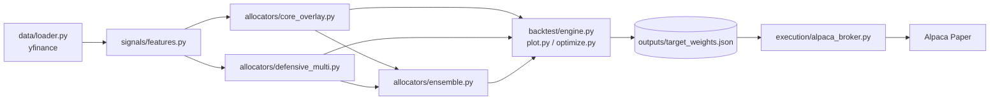
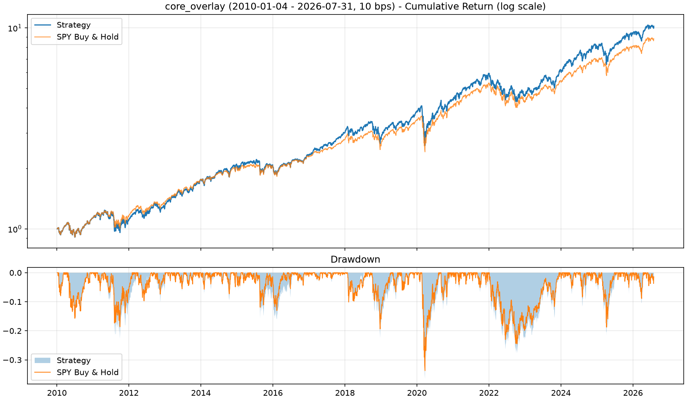
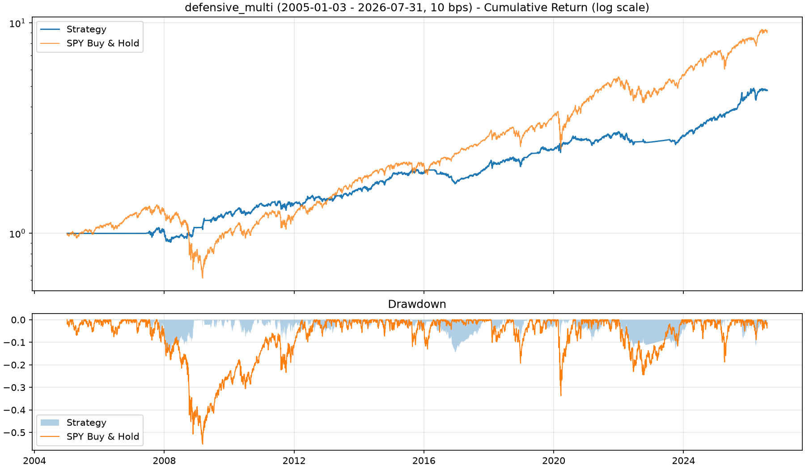
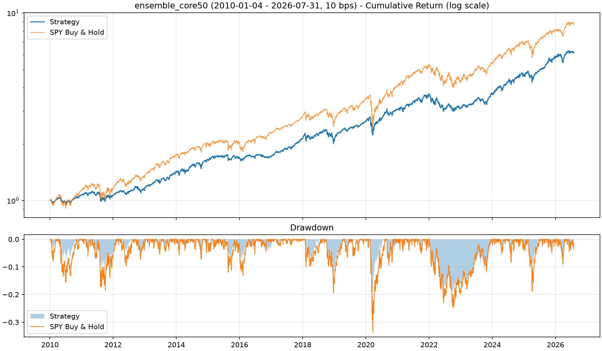

# unified-regime-portfolio

## なぜこのリポジトリが必要なのか

クオンツ戦略のバックテストでは良い成績が出ているのに、実運用に移すと機能しなくなるケースは少なくない。その主な原因は以下の3つの分断と市場構造の変化にあると考えられる。

1. **リターン予測への偏重と市場構造リスクの見落とし**  
   モメンタムやトレンドなどの単一シグナルだけでは、ポジションの過密化（Crowding）による分散効果の崩壊や、流動性枯渇（Liquidity Stress）による急落に対応できない。
2. **戦略アプローチの比較基準の不一致**  
   「市場ベータ（SPY）を維持しながら条件付きでアルファを上乗せするアプローチ」と、「市場ストレスに応じてエクスポージャーを縮小しキャッシュ（BIL）へ退避するアプローチ」は、本来同じデータ基盤・同じ取引コスト前提の上で比較されるべきだが、個別のスクリプトで検証すると前提条件が揃わない。
3. **リサーチ層と執行（Execution）層の分断**  
   バックテストで算出した目標ウェイトを、手動で発注スクリプトへ転記したり直書きしたりする運用は、誤発注や過剰売買、意図しないレバレッジといったオペレーション事故の温床になる。

このリポジトリは、これら3つの課題を解決するために設計している。ボラティリティ・資産間相関・Amihud非流動性という共通の市場ストレス指標をベースに、対照的な2つのETFポートフォリオ戦略を同一エンジン上で公平に比較して任意の資金比率で合成し、算出された最新ウェイトを6つの安全ガード付きでAlpacaのペーパー口座へ発注・監査するまでの一連のフローを単一のCLIで完結させている。

---

## 設計思想

1. **データ基盤の統一**  
   リターンの計算には株式分割や分配金を反映した調整後終値を使い、Amihud非流動性の計算には未調整の終値×出来高（ドル出来高）を使っている。用途に応じて価格系列を分けて取得する共通ローダーにより、過去の売買代金データの歪みを防いでいる。
2. **Strategyパターンによるアロケーターの抽象化**  
   どちらの戦略も `generate_daily_weights(prices, dollar_vol)` という共通のインターフェースを持っている。CLIの `--strategy` 引数を変えるだけで戦略を切り替えられ、同じバックテストエンジン・同じコスト前提で直接比較できる。インターフェースが共通なので、2つの戦略の日次ウェイトを線形結合するだけの `EnsembleAllocator` で任意の資金比率に合成することもできる。
3. **リサーチと執行のJSONパイプライン結合**  
   バックテストの完了時に最新日の目標ウェイトを `outputs/target_weights.json` へ自動的に書き出し、執行エンジンはこのファイルだけを読み込んで発注計画を立てる。人間が手でウェイトを書き換える工程をなくすことで、オペレーションミスを排除している。

---

## アーキテクチャ

```text
unified-regime-portfolio/
├── .env.example                 # Alpaca APIキー設定テンプレート
├── .gitignore
├── requirements.txt
├── README.md
├── main.py                      # 統合CLI（backtest / rebalance / audit）
├── outputs/                     # 実行時に生成（target_weights.json, 成績CSV, チャートPNG）
├── logs/                        # 実行時に生成（trade_log.jsonl, last_run.json）
└── src/
    ├── data/loader.py           # yfinance取得（調整後終値 + 未調整ドル出来高）
    ├── signals/features.py      # Zスコア、相関、Amihud、日次Crowdingスコア、月次シグナル
    ├── allocators/
    │   ├── base.py              # アロケーター抽象基底クラス
    │   ├── core_overlay.py      # 戦略①：SPYコア + ゲート付きオーバーレイ
    │   ├── defensive_multi.py   # 戦略②：月次モメンタム + 連続スケーリング + BIL退避
    │   └── ensemble.py          # 戦略①と②を任意の資金比率で合成
    ├── backtest/
    │   ├── engine.py            # shift(1)執行・コスト控除・成績指標・レジーム別評価
    │   ├── optimize.py          # core_overlay用の上限付きランダムサーチ
    │   └── plot.py              # 累積リターン・ドローダウン・レジーム別成績のPNG出力
    └── execution/
        └── alpaca_broker.py     # JSON読込・6つの安全ガード・冪等ロック・口座監査
```



依存の向きは `data` → `signals` → `allocators` → `backtest` / `execution` の一方向に統一している。執行層はウェイトの計算ロジックに関与せず、出力されたJSONの中身だけを参照して動作する。

---

## 搭載している2つの戦略

### 戦略① `core_overlay`

SPY 100%を常時コアとして保有し、市場環境が良好な条件がそろったときだけ小さな戦術的オーバーレイを上乗せする戦略となっている。

* **レジーム判定**：SPYの50日・200日移動平均と126日モメンタムを使って、強気相場と弱気相場を判定している。
* **強気かつ低混雑**：QQQ 60% / IWM 40% の比率で攻めのオーバーレイを構築する。
* **弱気かつ低混雑かつTLTが126日平均より上**：TLT 50% / GLD 50% の比率で守りのオーバーレイを構築する。
* **混雑度（Crowding）フィルター**：非流動性・ボラティリティ・資産間相関の252日Zスコアを `0.2 : 0.3 : 0.5` の重みで合成し、シグモイド関数で 0〜1 に変換している。その日までの拡張窓（Expanding Window）の80%分位点以下である日だけ、オーバーレイの保有を許可する。
* **IRゲート**：オーバーレイ単体の直近252日アクティブ情報比率（IR）がプラスのときだけ倍率 `k = 0.30` を掛けて有効化し、0以下のときはオーバーレイを停止する。
* **リバランスと上限**：5営業日ごとにリバランスを行う。オーバーレイ単体のグロス上限は30%、ポートフォリオ全体のグロス上限は130%に制限している。

`--optimize` オプションを付けると、データの先頭80%を使って上限付きランダムサーチ（最大200候補、60候補連続で改善がなければ早期終了）を実行し、末尾20%をホールドアウト期間として検証した結果を出力する。

### 戦略② `defensive_multi`

市場ストレスが高まった局面でエクスポージャーを滑らかに縮小し、余剰ウェイトを短期国債ETF（BIL）へ退避させてドローダウンを抑える戦略となっている。

* **ベースウェイト**：12ヶ月リターン − 6ヶ月リターンの36ヶ月Zスコアが正の資産だけを残し、ボラティリティの逆数（逆ボラ）で重み付けして配分する（対象は SPY / QQQ / TLT / GLD）。
* **3つの倍率による連続的な縮小**：目標ボラ10% ÷ 平均実現ボラ（上限1.5）、`exp(-0.7 × 相関Z)`、`exp(-0.6 × 非流動性Z)`の3つの倍率を掛け合わせてリスク資産の比重を調整する。
* **BIL退避と上限キャップ**：縮小して余ったウェイトはBIL（短期国債ETF）へ配分する。過度なキャッシュ化による機会損失を防ぐため、BILが40%を超える月は超過分をリスク資産へ比例配分で戻している。
* **フォールバック**：正のモメンタムを持つ資産が1つもない月やボラティリティ計算に必要なデータが不足している初期期間は、安全のためBIL 100%へ退避する。

### 2戦略のブレンド `ensemble`

戦略①と戦略②を任意の資金比率で合成する。どちらも同じ形式の日次ウェイトを出力するので、戦略①への資金配分比率を $\alpha \in [0, 1]$ とすると合成ポートフォリオのウェイトは単純な線形結合で求まる。

$$
W_{\mathrm{blend}}(t) = \alpha \, W_{\mathrm{core}}(t) + (1 - \alpha) \, W_{\mathrm{def}}(t)
$$

* **比率の指定**：`--strategy ensemble --core-ratio 0.7` のように戦略①の割合を 0.0〜1.0 で指定する（省略時は 0.5）。1.0 なら `core_overlay` 単体、0.0 なら `defensive_multi` 単体と完全に一致する。
* **補完関係**：戦略①は高ベータの攻めの戦略、戦略②は低ベータでBILへ退避する守りの戦略で、日次リターンの相関は 0.35 にとどまる。上昇相場では戦略①がリターンを稼ぎ、ストレス局面では戦略②のBIL退避がクッションになる。
* **執行との接続**：合成後のウェイトも単体戦略と同じく `target_weights.json` に書き出され、資金比率と両戦略のパラメータも記録される。そのまま執行エンジンで発注できる。

---

## バックテストの前提と品質検証

### 前提条件

* $t$ 日のウェイトは $t$ 日の終値までの情報だけで決定し、先読みを防ぐために $t+1$ 日のリターンへ適用している（`shift(1)`）。
* 取引コストは、ウェイト変化の絶対値合計に `--cost-bps`（10bps）を掛けて日次リターンから控除。
* 月次戦略（`defensive_multi`）は暦月末のラベルでシグナルを計算し、そのラベル日以降の最初の営業日からウェイトを適用する。当月の途中までのデータは使用しない。
* レジーム別成績（`LOW_CROWD` / `HIGH_CROWD`）は、全期間の80%分位点で事後的に分割した参考値として出力している。
* `ensemble` は2戦略の目標ウェイトを毎日合成するため、資金比率が常に一定に保たれる前提で評価している。

---

## 執行の安全ガード

実運用時のオペレーション事故を防ぐため、執行エンジンには6つの安全ガードを組み込んでいる。

| # | ガードの内容 | 既定値 |
| --- | --- | --- |
| 1 | `--submit` を明示的に付けない限り発注計画の表示のみで終了する（口座も `paper=True` に固定） | dry-run |
| 2 | 1注文あたりの想定元本の上限をチェックする | `--max-notional 2000` |
| 3 | 「総売買代金 ÷ 口座評価額（回転率）」の上限をチェックする | `--max-turnover 0.10` |
| 4 | 1回の実行で送信できる注文数の上限をチェックする | `--max-orders 5` |
| 5 | 最小発注金額に満たない端数の差分注文はスキップする | `--min-notional 20` |
| 6 | UTC日付で1日1回までの送信ロックを掛け、未約定の注文が残っている場合も送信を停止する | `logs/last_run.json` |

* `target_weights.json` に記載されている銘柄だけを管理対象としている。ウェイトが `0` の銘柄は全株売却し、ファイルに記載のない別保有銘柄には一切触れない。
* 買付余力（キャッシュ）を確実に確保するため、売り注文を先に送信してから買い注文を出す順序制御を行っている。
* ドライラン、ガードによる停止、実送信のすべての履歴を `logs/trade_log.jsonl` に記録して監査できるようにしている。

※ 既定の上限値は、運用開始後の少額なリバランス調整を想定した設定になっている。空の口座から初めてポジションを建てるときはガード2と3に引っかかって停止するため、まずはドライランで計画を確認したうえで、`--max-notional` と `--max-turnover` を引き上げて実行する必要がある。また、`core_overlay` の既定ウェイトはグロス最大130%（`ensemble` の 50:50 では最大115%）となるため、信用取引の買付余力も使用する。


## 参考成績とパフォーマンス推移

同一条件（期間：2010-01-04〜2026-07-31、取引コスト：10bps、既定パラメータ）での比較結果を示している。`yfinance` の調整後終値はETFの分配金が出るたびに過去分も再計算されるため、実行日によって数値はわずかに変動する。`ensemble` の括弧内は `core_overlay` と `defensive_multi` の資金比率を表す。

| 戦略 / ベンチマーク | CAGR | Vol | Sharpe | MDD | Beta | Alpha |
| --- | --- | --- | --- | --- | --- | --- |
| **core_overlay** | 15.07% | 18.89% | 0.84 | -36.53% | 1.09 | -0.14% |
| **ensemble (70:30)** | 13.11% | 14.25% | 0.94 | -26.91% | 0.81 | 1.52% |
| **ensemble (50:50)** | 11.65% | 11.49% | 1.02 | -20.18% | 0.62 | 2.63% |
| **ensemble (30:70)** | 10.06% | 9.30% | 1.08 | -16.76% | 0.43 | 3.74% |
| **defensive_multi** | 7.47% | 8.08% | 0.93 | -14.57% | 0.15 | 5.40% |
| **SPY (Buy & Hold)** | 14.07% | 17.10% | 0.86 | -33.72% | 1.00 | 0.00% |







* **`core_overlay` の特徴**：SPYを上回る累積リターンを記録しているが、その超過分は主にベータ（1.09）のレバレッジ効果によるもので、既定パラメータにおけるCAPMアルファはほぼゼロ（-0.14%）となっている。コロナショック（2020年）や2022年の下落局面でもSPYに近いドローダウンを受けている。
* **`defensive_multi` の特徴**：実現ボラティリティを年率換算してから目標ボラティリティ10%と比較しているため、ボラティリティ倍率の中央値は約0.7、BILの保有比率の中央値は40%になっている。上昇相場での追随率は抑えられるが、2008年のリーマンショック、2020年のコロナショック、2022年の株債同時安のいずれにおいてもドローダウンを抑え、シャープレシオ 0.93 とアルファ +5.40% を出している。リスク水準を引き上げたい場合は `DefensiveMultiAllocator(target_vol=...)` の値を調整する。
* **`ensemble` の特徴**：50:50 のシャープレシオは 1.02 で、`core_overlay`（0.84）と `defensive_multi`（0.93）のどちらの単体も上回る。最大ドローダウンは -20.18% と `core_overlay` 単体のほぼ半分で、2020年のコロナショックでも `core_overlay` 単体の -36.5% に対して -20.2% にとどまった。一方でCAGRは 11.65% とSPYの 14.07% を下回るため、優れているのはリスク当たりのリターンであって絶対リターンではない。この期間でシャープレシオが最も高かったのは 30:70（1.08）だった。

---

## 注意事項

* ペーパー発注で使用する成行注文には実市場でのスリッページやスプレッドコストが発生するため、バックテストの前提とは約定価格が一致しない場合がある。
